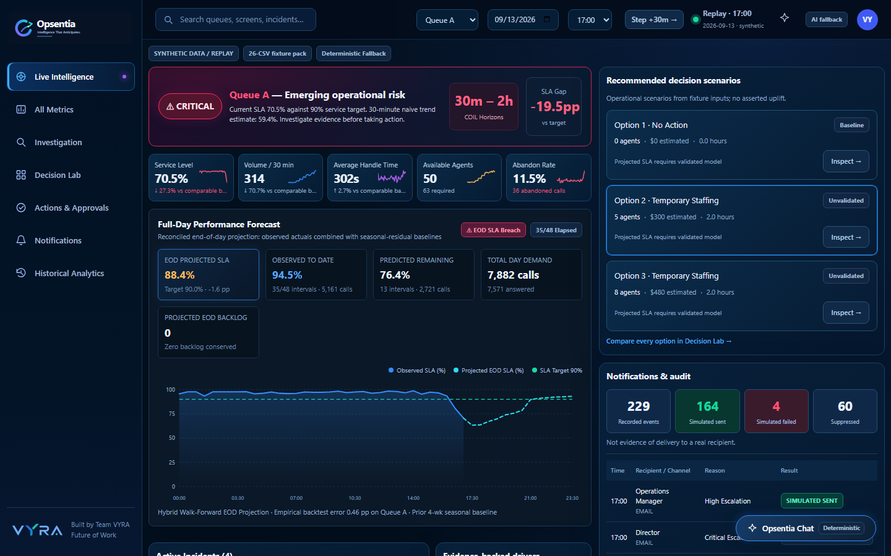
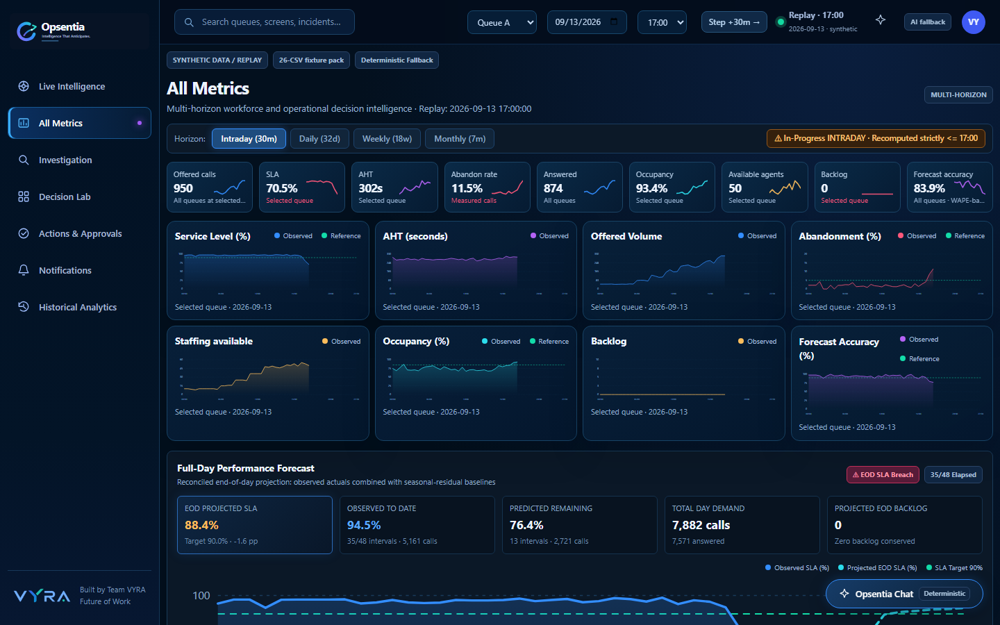
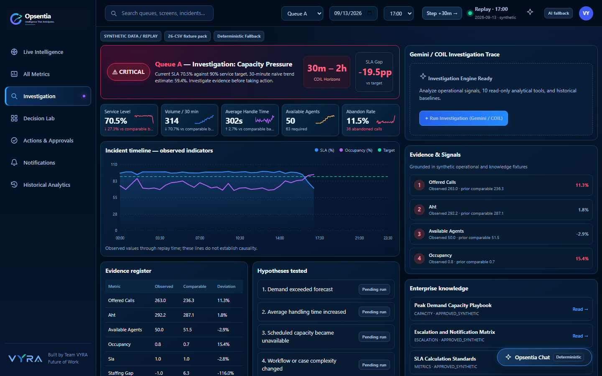
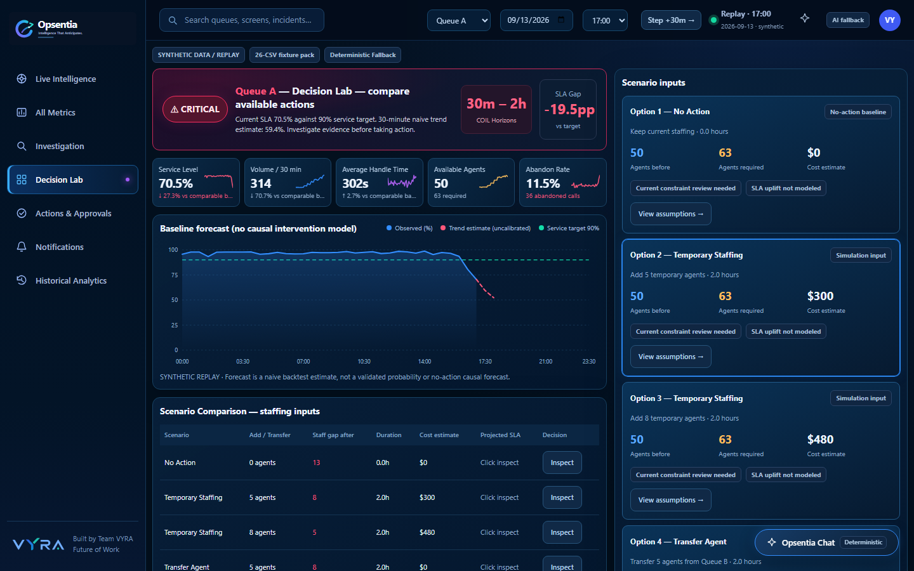
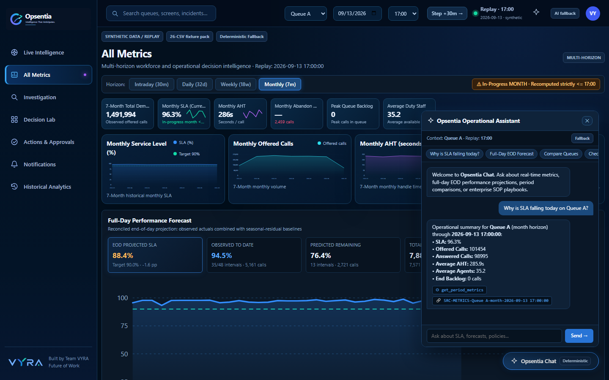
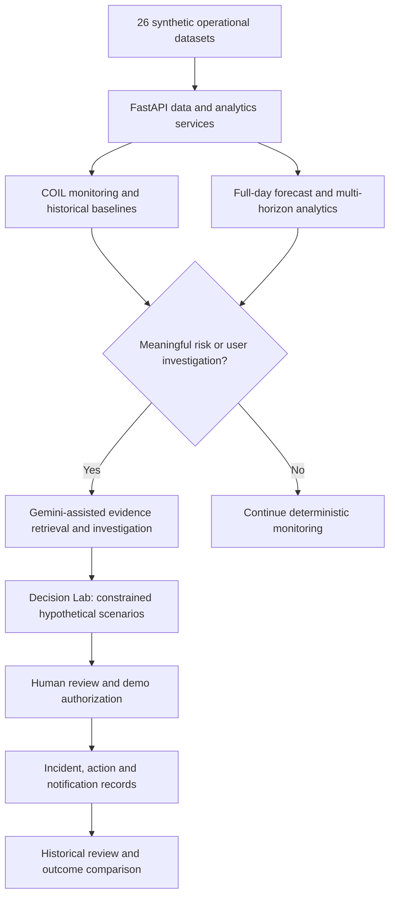

<div align="center">

# Opsentia

### Intelligence That Anticipates.

**An AI-assisted operational decision-intelligence prototype by Team VYRA**  
*Google Cloud AI Builder Cup 2026 · Future of Work & Enterprise Productivity*

**Anticipate risks · Investigate with evidence · Evaluate interventions · Keep humans in control**

</div>

---

## Overview

Most operations dashboards explain **what has already happened**. **Opsentia** is designed to help operations leaders identify **what may happen next**, investigate the reasons, evaluate their options, and document accountable decisions.

The prototype combines a deterministic **Continuous Operational Intelligence Loop (COIL)**, historical and full-day forecasts, **Google Gemini**-assisted investigations, conversational analytics, constrained scenario modeling, and human-controlled demonstration workflows. It is a **synthetic-data research prototype**, not a connected production workforce-management platform.

### At a glance

| Area | Prototype scope |
| --- | --- |
| Operational data | 26 synthetic CSV datasets |
| Primary history | 43,680 queue-interval records; five queues; 182 days |
| Analytics | Intraday, daily, weekly, monthly; queue-level and combined views |
| Predictive intelligence | COIL alerts, historical comparisons, full-day KPI forecasts and watch-outs |
| Google AI | Google Gen AI SDK, Gemini-assisted tool-based investigation and Ask Opsentia |
| Decision support | Hypothetical staffing/capacity interventions with donor-queue constraints |
| Governance | Demo-mode approvals, notifications, incident history and audit trail |
| Interface | Seven desktop workspaces plus an AI chat assistant |

> **Evidence and limitations:** Operational data, incidents and actions are synthetic or simulated. Forecasts and scenario projections are estimates, not guaranteed outcomes. Gemini requires explicit credentials and may use a labeled deterministic fallback when unavailable. Live Gemini execution and public Cloud Run deployment must be verified in the target environment; the presence of code or saved traces does not independently prove either.

## Product experience



### Seven integrated workspaces

| Workspace | Purpose |
| --- | --- |
| **1. Live Intelligence** | Monitor current/replayed KPIs, COIL signals, risk severity and active incidents. |
| **2. All Metrics** | Review intraday, daily, weekly and monthly performance, historical comparisons, full-day forecasts and watch-outs. |
| **3. Investigation** | Examine supporting metrics, competing explanations, historical incidents and AI investigation evidence. |
| **4. Decision Lab** | Model hypothetical staffing interventions, compare trade-offs and assess donor-queue protections. |
| **5. Actions & Approvals** | Review proposed actions and demo-mode approvals with auditable state changes. |
| **6. Notifications** | Review severity-linked alerts, escalation records and duplicate-suppression information. |
| **7. Historical Analytics** | Analyze longer-term trends, recurring incidents, historical KPI patterns and forecast performance. |

**Ask Opsentia** is a cross-workspace conversational assistant for questions about operational data, forecasts, history and policies. It uses bounded server-side analytical tools where configured and should not be treated as an unrestricted source of operational facts.

<details>
<summary><strong>Additional interface screenshots</strong></summary>

| All Metrics | Investigation |
| --- | --- |
|  |  |

| Decision Lab | Ask Opsentia |
| --- | --- |
|  |  |

</details>

## How it works



**Separation of responsibilities:** Python services calculate KPI metrics, forecasts, anomaly signals, and intervention math. Gemini selects or uses supported analytical tools to investigate context and explain evidence. Human approval remains necessary for consequential actions.

### COIL and proactive AI

COIL analyzes incoming/replayed KPI observations and signals material deviations. The repository also includes an **opt-in Gemini supervision hook** in `backend/supervisor.py` with risk-change detection and cooldown logic. Its availability **does not mean a continuously running production scheduler or managed worker is deployed**. A real scheduler, durable event storage, monitoring and access control are needed for production operation.

## Technology stack

| Layer | Technology |
| --- | --- |
| Web experience | HTML, CSS, vanilla JavaScript and SVG charts |
| API | Python 3.11+, FastAPI, Pydantic, Uvicorn |
| Data and metrics | pandas, CSV replay fixtures, deterministic calculation services |
| AI | Google Gemini using the `google-genai` SDK and tool/function calling |
| Forecasting | Observed-to-date results plus historical patterns and remaining-interval projections |
| Quality | pytest, data preflight checks, browser capture scripts |
| Packaging | Docker; Google Cloud Run deployment target |
| Local audit persistence | Demo JSON/event state (**not** a durable multi-instance database) |

## Repository structure

```text
.
├── backend/
│   ├── app.py                   # FastAPI routes and web app
│   ├── agent.py                 # Gemini investigation and analytical tools
│   ├── assistant.py             # Ask Opsentia chatbot
│   ├── analytics.py             # Multi-horizon metrics
│   ├── business_metrics.py      # KPI definitions and aggregation
│   ├── coil.py                  # COIL monitoring
│   ├── forecast_service.py      # End-of-day forecasts and backtesting
│   ├── supervisor.py            # Opt-in AI supervision trigger
│   ├── simulation.py            # Staffing and donor-queue scenarios
│   └── incidents.py             # Incidents, actions and approvals
├── data/                        # 26 synthetic CSV fixtures and demo state
├── frontend/app/
│   ├── index.html
│   └── assets/                  # App JS, stylesheet and branding
├── docs/                        # Architecture, APIs, benchmark notes and screenshots
├── scripts/
│   ├── preflight_data.py
│   └── browser_test_and_capture.py
├── tests/                       # Automated regression tests
├── .github/workflows/ci.yml     # GitHub Actions test workflow
├── .env.example                 # Configuration template (no secrets)
├── Dockerfile
├── requirements.txt
└── README.md
```

## Run locally

### Requirements

- Python **3.11 or newer**
- Windows PowerShell, macOS terminal or Linux shell
- A modern desktop browser
- An optional **Google Gemini API key** for actual model-generated responses

### 1. Clone and install

```bash
git clone https://github.com/YOUR_USERNAME/opsentia-ai.git
cd opsentia-ai
python -m pip install -r requirements.txt
```

Replace `YOUR_USERNAME` with your GitHub username and ensure the repository has been created. Alternatively, extract the project ZIP and open a terminal in its root directory.

### 2. Configure optional Gemini access

Review `.env.example`. **The application reads environment variables directly; simply copying `.env.example` to `.env` does not automatically load it.**

For **Windows PowerShell**:

```powershell
$env:GEMINI_API_KEY = "YOUR_GEMINI_API_KEY"
$env:GEMINI_MODEL = "YOUR_SUPPORTED_GEMINI_MODEL_ID"
$env:PUBLIC_DEMO_READ_ONLY = "true"
```

For **macOS / Linux**:

```bash
export GEMINI_API_KEY="YOUR_GEMINI_API_KEY"
export GEMINI_MODEL="YOUR_SUPPORTED_GEMINI_MODEL_ID"
export PUBLIC_DEMO_READ_ONLY="true"
```

Select a supported model enabled for your project. No API key is needed to inspect synthetic datasets or use deterministic analytics and fallback features. **Never commit actual credentials, `.env` files or operator tokens.**

### 3. Validate data and start the app

```bash
python scripts/preflight_data.py
python -m uvicorn backend.app:app --reload --port 8080
```

Open:

- **Web dashboard:** http://127.0.0.1:8080/
- **Interactive API documentation:** http://127.0.0.1:8080/docs
- **Health/status:** http://127.0.0.1:8080/api/health

For the synthetic incident demonstration, select **Queue A**, **September 13, 2026**, and the **16:30** replay interval.

## Testing

Run the built-in quality checks:

```bash
python scripts/preflight_data.py
python -m pytest -q
```

The automated tests cover core analytics, COIL, API contracts, forecast logic, decision simulation, chat behavior and approval controls. A live Gemini integration test may skip without valid credentials. Passing the test suite **does not independently verify production security, model quality or deployment**.

For a browser screenshot/capture check, inspect the prerequisites in `scripts/browser_test_and_capture.py` and run it against a locally available server.

See [business and dataset contracts](docs/BUSINESS_LOGIC_AND_DATA.md), [forecast/COIL notes](docs/COIL_AND_FORECAST_ENGINE.md), and [API specification](docs/API_SPEC.md).

## Useful API routes

| Route | Method | Use |
| --- | --- | --- |
| `/api/health` | `GET` | Runtime mode and verification flags |
| `/api/ui/bootstrap` | `GET` | Initial desktop dashboard data |
| `/api/analytics` | `GET` | Multi-horizon performance analytics |
| `/api/forecasts/full-day` | `GET` | Observed + projected end-of-day metrics |
| `/api/forecasts/full-day/backtest` | `GET` | Historical forecast evaluations |
| `/api/coil/snapshot` | `GET` | COIL operational signals |
| `/api/coil/watchouts` | `GET` | Operational watch-outs |
| `/api/investigate` | `POST` | Request evidence-based investigation |
| `/api/assistant/chat` | `POST` | Conversational operational queries |
| `/api/simulations` | `POST` | Model hypothetical interventions |
| `/api/coil/supervisor/status` | `GET` | AI supervisor status |

API behavior, authorization and request schemas are documented in `/docs` and [docs/API_SPEC.md](docs/API_SPEC.md). Model capabilities must be confirmed through a real server-side Gemini trace, not a canned response.

## Run with Docker

```bash
docker build -t opsentia:demo .
docker run --rm -p 8080:8080 -e PUBLIC_DEMO_READ_ONLY=true opsentia:demo
```

Then visit http://127.0.0.1:8080/.

**Cloud Run** is the intended managed hosting target. Review [deployment instructions](docs/DEPLOYMENT_AND_SECURITY.md) before publishing. The deployment needs a real Google Cloud project, billing/permissions, secure secret injection and external smoke tests. This repository by itself does not verify that a public Cloud Run service exists.

### Demo security posture

- Public/demo access should remain **read-only** (`PUBLIC_DEMO_READ_ONLY=true`).
- Mutation-capable sessions require a separately provided `OPSENTIA_OPERATOR_TOKEN`; **do not embed it in frontend code or public repository files**.
- Read-only analytical endpoints are distinct from action/approval mutation endpoints.
- Local JSON records and in-memory state are **not reliable cross-instance persistence**. Use an appropriate managed database and enterprise identity provider before production use.
- The notification ledger is demonstrative; do not infer real SMS, email or Slack delivery from simulated statuses.

## Data, benchmarks and limitations

All operating records are **synthetic**. The 30-minute warning for Queue A on September 13 is an **illustrative replay event**, not a population-wide guarantee of detection lead time. Published example forecast errors should be interpreted as checkpoint-specific, not as generalized predictive accuracy. Models and uncertainty bands require out-of-sample calibration; capacity scenarios are hypothetical, and their projected uplift should not be claimed as causal proof.

Keep temporal replay boundaries (`as_of`) respected when answering historical questions. Combined queue metrics require correct time-bucket aggregation, sums for staffing, and denominator-weighted KPI calculations. See [benchmark notes](docs/BENCHMARKS.md) and [data contracts](docs/DATA_CONTRACT.md).

## Documentation

- [System architecture](ARCHITECTURE.md)
- [Product requirements](PRD.md)
- [API specification](docs/API_SPEC.md)
- [Google AI tool design](docs/GEMINI_ADK_TOOLS.md)
- [COIL and forecasting](docs/COIL_AND_FORECAST_ENGINE.md)
- [Decision simulation](docs/DECISION_SIMULATION.md)
- [Security and deployment](docs/DEPLOYMENT_AND_SECURITY.md)
- [Dataset reconciliation](docs/DATA_CONTRACT.md)
- [Benchmarks](docs/BENCHMARKS.md)
- [GitHub publication guide](docs/GITHUB_SETUP.md)

## Project status

Opsentia is a **functioning demonstration prototype** with read-only analysis, synthetic replay, AI integration pathways and simulated governance workflows. Real Gemini output depends on credentials and runtime availability. Public cloud deployment, durable event storage, enterprise authentication and claims of statistically calibrated prediction quality require separate verification.

No production operating system is connected and no real staffing, customer, or financial action is executed by this demonstration.

---

<div align="center">

**Opsentia — Intelligence That Anticipates.**  
**Team VYRA**  
*Know sooner. Understand better. Decide responsibly.*

</div>
